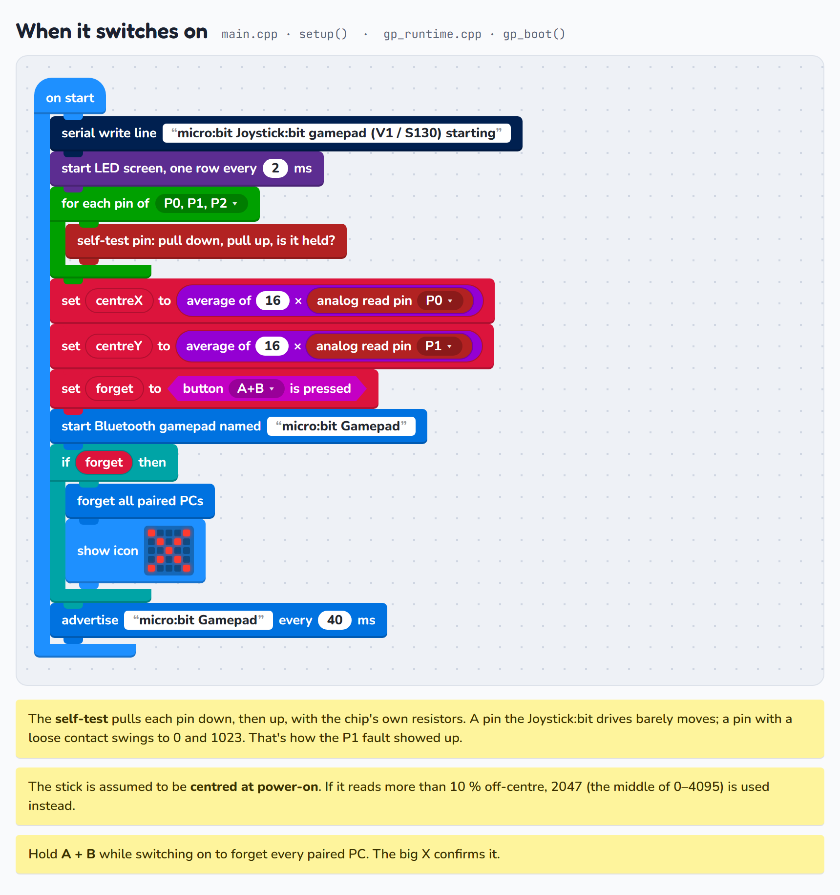
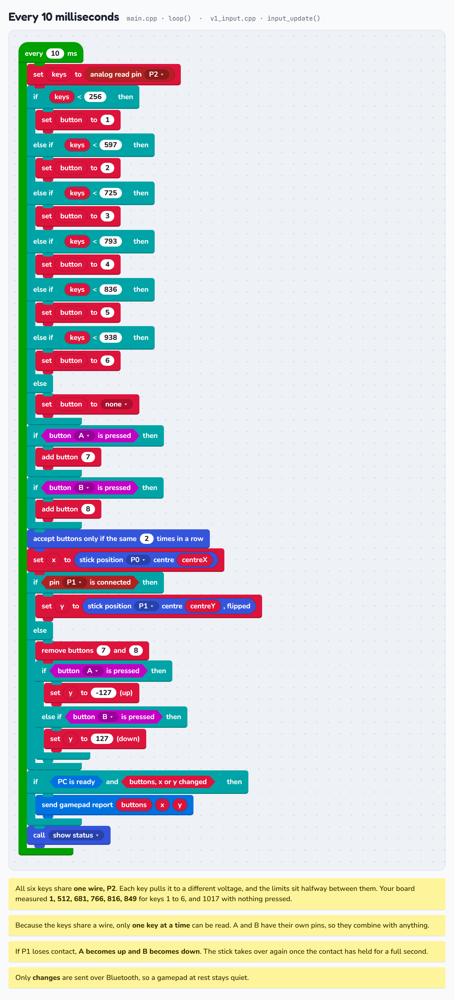
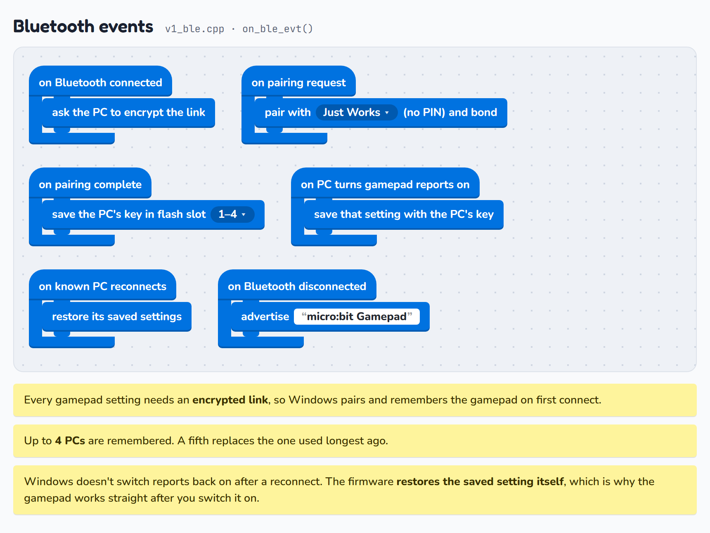
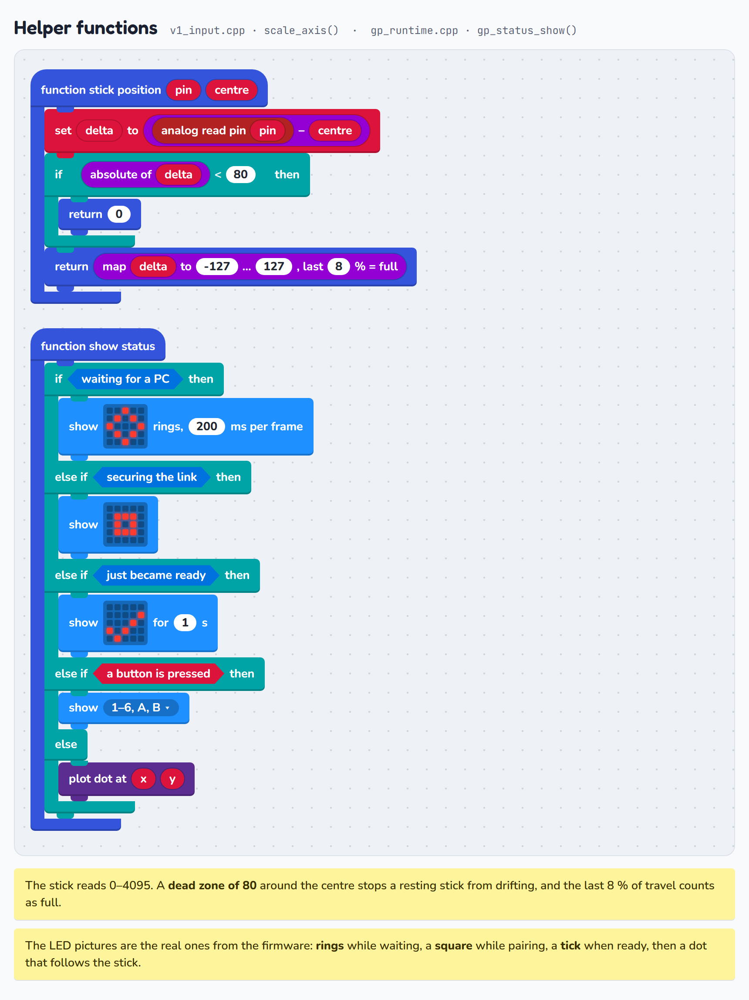
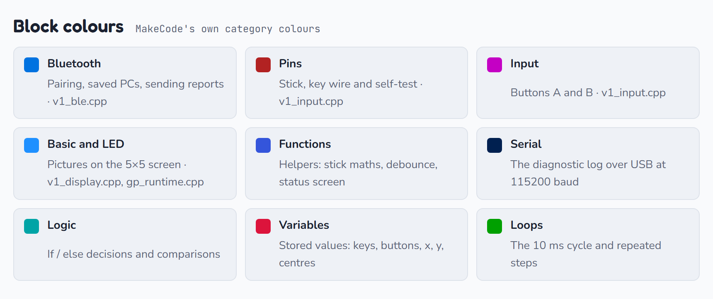

# micro:bit Bluetooth Gamepad (Joystick:bit V1 → Windows 11)

Firmware that turns a **BBC micro:bit** in an **ELECFREAKS Joystick:bit V1 (EF03407)** into a
Bluetooth LE game controller. Windows 11 uses its own HID-over-GATT driver, so you don't need
to install anything on the PC. It shows up as **micro:bit Gamepad** with 8 buttons and an X/Y stick.

- [Which micro:bit do I have?](#which-microbit-do-i-have)
- [Controls](#controls)
- [Build & flash](#build--flash)
- [Pairing with Windows 11](#pairing-with-windows-11)
- [Gamepad tester](#gamepad-tester)
- [Block editor: change the firmware without C++](#block-editor-change-the-firmware-without-c)
- [How the firmware works, as blocks](#how-the-firmware-works-as-blocks)
- [Serial log](#serial-log)
- [Troubleshooting](#troubleshooting)
- [Project layout](#project-layout)

## Which micro:bit do I have?

Open the **MICROBIT** drive and look at `DETAILS.TXT` → `Unique ID`:

| Unique ID starts with | Board | PlatformIO env | Stack |
|---|---|---|---|
| `9900` / `9901` | **V1.x** (nRF51822, 16 KB RAM) | `microbit_v1` *(default)* | Arduino nRF5 core + Nordic **S130** SoftDevice |
| `9903` and up    | **V2.x** (nRF52833)            | `microbit_v2`             | Zephyr RTOS 4.4 |

The V1 is too small for Zephyr's Bluetooth stack, so it uses Nordic's S130 SoftDevice. Both
builds behave the same. The self-test and the A/B up/down fallback described below are V1 only.

## Controls

| Hardware                    | micro:bit pin        | Windows sees |
|-----------------------------|----------------------|--------------|
| Joystick left/right         | P0 (analog)          | X axis       |
| Joystick up/down            | P1 (analog)          | Y axis       |
| Joystick:bit keys 1–6       | P2 (one shared wire) | Buttons 1–6  |
| micro:bit button A          | P5                   | Button 7 (Y up while the stick's up/down is dead) |
| micro:bit button B          | P11                  | Button 8 (Y down while the stick's up/down is dead) |

* **Keys 1–6 share one wire.** Each key pulls P2 to a different voltage, so the board can only
  report **one key at a time**. Press one key at once. A and B have their own pins, so they combine
  with anything.
* **Stick direction** was checked on a real Joystick:bit V1: left reads low on P0 and up reads
  high on P1. That means `GP_INVERT_X 0` and `GP_INVERT_Y 1` in `src/gamepad.h`. The ELECFREAKS wiki
  claims the opposite for left/right.
* **Broken up/down fallback (V1):** on every sample (every 10 ms), the firmware checks whether the
  stick's up/down pin (P1) is actually connected. While it isn't, for example because of a loose
  contact on the Joystick:bit, **A = up and B = down**. If the contact holds for a full second, the
  stick takes over and A/B go back to being buttons 7/8. A flickering contact never sends junk
  readings. This rule is the *if stick up/down is connected* block in the
  [block editor](#block-editor-change-the-firmware-without-c), so you can change or remove it there.

## Build & flash

PlatformIO isn't on `PATH` by default. Use `%USERPROFILE%\.platformio\penv\Scripts\pio.exe`, or
the PlatformIO IDE.

```powershell
pio run -t upload                    # V1 (default env)
pio run -e microbit_v2 -t upload     # V2
pio device monitor                   # log at 115200 baud (see "Serial log")
```

The first V2 build downloads Zephyr and its modules, which takes several minutes.

**V1 after MakeCode:** MakeCode (micro:bit DAL) programs leave a DFU bootloader on the chip and
register it in the UICR. If it stays there, the gamepad never starts and the LEDs stay dark.
`pio run -t upload` detects this and does a one-time **full chip erase** first
(`tools/v1_flash.tcl`). Later uploads keep the stored pairings.

## Pairing with Windows 11

There's nothing to switch on. **Whenever the gamepad isn't connected, it is discoverable.**

1. Switch on the Joystick:bit (or plug in USB). The LEDs show **expanding rings**, which is
   pairing mode.
2. On the PC, go to **Settings → Bluetooth & devices → Add device → Bluetooth**.
3. Pick **micro:bit Gamepad**. Windows pairs with "Just Works", so there's no PIN to enter.
4. The LEDs show a **hollow square** while the link is being secured. They then show a **tick**,
   followed by a dot that follows the stick (or the number of the key you press).
5. To test, press **Win+R** → `joy.cpl` → *micro:bit Gamepad* → **Properties**.

After that, Windows **reconnects by itself** whenever you switch the gamepad on.

| LEDs | Meaning |
|---|---|
| Expanding rings | Advertising, waiting for a PC (pairing mode) |
| Hollow square   | Connected, securing the link / Windows enabling input |
| Tick, then dot  | Ready. The dot shows the stick; pressed keys show `1`–`6`, `A`, `B` |
| Big **X**       | All pairings deleted (A + B held at power-on) |
| `!`             | Bluetooth stack failed to start (see serial log) |

## Gamepad tester

Visualize the joystick and all eight buttons in a browser. From the project directory run:

```powershell
python -m http.server 8000 --bind 127.0.0.1
```

Open `http://127.0.0.1:8000/tools/gamepad-tester/` in a current browser, pair the gamepad
with Windows, and press a controller button to make it visible to the browser. The tester
shows live input and remembers which buttons you have pressed until you reset the check or
choose another controller. It uses the browser Gamepad API; no input is sent to a server.
The visual labels follow this project's default firmware mapping. Keys 1–6 share a wire, so
test them one at a time. On V1, A and B may control the Y axis while its contact is disconnected.

The tester includes a **Read Bluetooth battery** button when Web Bluetooth is available. Select your controller to read its Battery Service value. The current V1 firmware reports a fixed **100%**, because the Joystick:bit supplies no battery reading; this is not a measurement of remaining charge. The page labels this limitation and shows the selected Bluetooth device separately from the gamepad selection.

### How pairing works

* Every HID characteristic requires an encrypted link. On connect, the gamepad sends a security
  request, so Windows pairs and **bonds**. V1 uses LE legacy Just Works pairing; V2 uses LE Secure
  Connections Just Works.
* Bonds are stored in flash, up to 4 PCs. When the list is full, the oldest bond is replaced.
* The PC's "notifications on" setting (its CCCD subscription) is stored with the bond and
  restored on reconnect. Windows doesn't re-subscribe by itself, so without this the gamepad
  would connect after a power cycle but send nothing.
* If you click **Remove device** in Windows and pair again, it works without touching the gamepad.
* The gamepad advertises as a Gamepad (appearance 0x03C4) with the HID and Battery services. It
  also provides Device Information with a PnP ID (VID 0x1209 / PID 0x0001, the pid.codes test ID).

### Forget all pairings

Hold **A + B** while switching on (or while pressing the reset button on the back) until the big
**X** appears, then release. **Also remove "micro:bit Gamepad" in Windows**, or Windows will keep
trying the old key.

## Block editor: change the firmware without C++

`src/v1/main.cpp` is **generated from blocks**. Remap keys, change what A/B do, or rename the
gamepad by dragging blocks, then download a .hex file and drop it onto the micro:bit (V1 only).

```powershell
python tools/blocks_editor.py        # opens the editor at http://127.0.0.1:8765/
```

The editor is built on [Blockly](https://developers.google.com/blockly), the block library behind
MakeCode and Scratch. It needs an internet connection the first time to load Blockly from unpkg.

* The left side holds the blocks and the right side shows the generated `main.cpp`, which updates
  as you edit.
* The workspace starts empty. Drag blocks from the categories to build your own program.
* **? Solution help** opens the complete default solution in a separate, read-only window. Zoom or
  scroll to inspect it while you build. **Open saved** restores a previously saved project.
* **Save** writes `blocks/gamepad.json` (your blocks) and `src/v1/main.cpp` (the C++). If you
  started with an empty workspace, the editor asks before replacing an existing saved project.
* **Download** saves, builds the firmware on your PC with PlatformIO (`pio run`), and downloads
  **`microbit-gamepad.hex`**. While it builds, the *Build log* tab shows PlatformIO's output live.
* **Load firmware default** restores the blocks that match the original firmware.

To put the download on the micro:bit, the same way as with MakeCode:

1. Plug the micro:bit in with a USB data cable. It appears as the **MICROBIT** drive.
2. Drag `microbit-gamepad.hex` from your Downloads onto the **MICROBIT** drive. The yellow light
   on the back flashes while it copies, then the micro:bit restarts with your blocks.
3. If the gamepad then stays on the hollow square instead of connecting, its saved pairing no longer
   matches Windows (for example, it was cleared). Remove **micro:bit Gamepad** in Windows Bluetooth
   settings and pair again.

`microbit-gamepad.hex` is a complete image (Nordic's Bluetooth stack plus your program), so you
can also hand it to anyone with the same micro:bit V1 + Joystick:bit V1, even without PlatformIO.
To be sure the pairing is kept, flash from a terminal instead with `pio run -t upload`, which
rewrites only the firmware area.

How it fits together:

| Layer | File | Edited by |
|---|---|---|
| Your program | `blocks/gamepad.json` → `src/v1/main.cpp` | the block editor |
| Block-sized functions (`gp_press`, `gp_stick`, …) | `src/v1/gp_runtime.cpp/.h` | C++ (rarely) |
| Bluetooth, LED screen, pin reading | `src/v1/v1_ble.cpp`, `v1_display.cpp`, `v1_input.cpp` | C++ (rarely) |

Each block generates one `gp_*()` call. For example, *if Joystick:bit key 1 is pressed, press
gamepad button 1* becomes:

```cpp
if (gp_key_pressed(1)) {
	gp_press(1);
}
```

| Block category | Blocks |
|---|---|
| Events | **on start**, **every N ms** (reads inputs and starts an empty report first) |
| Gamepad | press gamepad button 1–8, set gamepad X/Y to a value (−127…127) |
| Keys & buttons | Joystick:bit key 1–6 is pressed, button A/B is pressed, A+B held at power-on, wait until A and B are released |
| Stick | stick X/Y position, stick X/Y is connected, analog read pin P0–P2 |
| Bluetooth | start Bluetooth gamepad named "…", forget all paired PCs, send gamepad report |
| LEDs | show status on LEDs, show icon |
| Logic, Math | if / else, compare, and / or / not, numbers, + − × ÷ |

The server only answers on `127.0.0.1`, and every save or build needs a token that's embedded in
the page, so other websites can't trigger it. Don't edit `src/v1/main.cpp` by hand, because the
next save overwrites it. To change what a block can do, add a function to `gp_runtime.h`, then a
block and its generator in `tools/blocks_editor/gp_blocks.js`.

## How the firmware works, as blocks

The firmware is C++ (`src/v1/`), but here it is drawn the way MakeCode draws a program, using
MakeCode's own block colours and the firmware's real LED pictures. **These are pictures for
reading.** They aren't a MakeCode project you can load. The [block editor](#block-editor-change-the-firmware-without-c)
is the version you can edit. Open
[`docs/blocks/firmware-blocks.html`](docs/blocks/firmware-blocks.html) in a browser for the full
page with the animated rings.

### When it switches on

`main.cpp · setup()`, `gp_runtime.cpp · gp_boot()`

<picture>
  <source media="(prefers-color-scheme: dark)" srcset="docs/blocks/start-dark.png">
  
</picture>

### Every 10 milliseconds

`main.cpp · loop()`, `v1_input.cpp · input_update()`

<picture>
  <source media="(prefers-color-scheme: dark)" srcset="docs/blocks/loop-dark.png">
  
</picture>

### Bluetooth events

`v1_ble.cpp · on_ble_evt()`

<picture>
  <source media="(prefers-color-scheme: dark)" srcset="docs/blocks/bluetooth-dark.png">
  
</picture>

### Helper functions

`v1_input.cpp · scale_axis()`, `gp_runtime.cpp · gp_status_show()`

<picture>
  <source media="(prefers-color-scheme: dark)" srcset="docs/blocks/functions-dark.png">
  
</picture>

### Block colours

<picture>
  <source media="(prefers-color-scheme: dark)" srcset="docs/blocks/legend-dark.png">
  
</picture>

To regenerate the images after editing the page, run `python tools/render_blocks.py`. It uses
headless Chrome or Edge.

## Serial log

`pio device monitor` (115200 baud) shows what the gamepad is doing. Useful lines:

| Line | Meaning |
|---|---|
| `P1 (stick Y) pull-down/up test: 419 / 592 -> connected` | Power-on self-test. A connected pin barely moves. |
| `... 5 / 993 -> NOT CONNECTED` | Nothing drives that pin: a bad edge contact or a broken joint on the Joystick:bit. |
| `P1 (stick Y) contact LOST` / `contact OK` | The up/down contact dropped or came back while running. |
| `Up/down from micro:bit A (up) / B (down)` | The A/B fallback is active. |
| `P2=766 -> key 4`, `Buttons: 4` | Raw key-wire reading and the debounced buttons. |
| `Stick raw X=2044 Y=2040 -> x=0 y=0` | Raw stick readings (0–4095) and the values sent (−127…127). |
| `Pairing request` → `Paired and bonded` → `PC enabled input reports` | A successful first pairing. |
| `Known PC, re-encrypting (bond 0)` | A paired PC reconnected. |

## Troubleshooting

| Symptom | Fix |
|---|---|
| LEDs stay dark (V1) | The old MakeCode bootloader is still there. Flash once with `pio run -t upload` (it clears the bootloader); after that, dropping `microbit-gamepad.hex` works too. |
| No rings, it connected straight away | A PC it bonded with before reconnected. Turn off that PC's Bluetooth, or wipe bonds with A + B. |
| Not listed under *Add device* | Settings → Bluetooth & devices → Devices → **Bluetooth devices discovery = Advanced**, then try again. |
| Windows says *Paired* but stays at the square / keeps reconnecting | The two sides disagree about the bond. This happens after wiping bonds or a full chip erase. Remove the device in Windows and pair again. The serial log says `Unknown key`. |
| Up/down (or left/right) does nothing | Check the power-on self-test in the serial log. `NOT CONNECTED` means the Joystick:bit's signal isn't reaching that pin. Reseat the micro:bit fully, clean its gold edge pads, and tighten the screws if your board has them. Until it's fixed, up/down comes from A/B. |
| Two keys pressed give the wrong key | The six keys share one wire, so press one at a time. |
| Changed the HID report descriptor | Windows caches it. Remove the device in Windows and pair again. |
| Axis reversed | Flip `GP_INVERT_X` / `GP_INVERT_Y` in `src/gamepad.h`. |
| Stick drifts | Keep the stick centred at power-on (that's when it calibrates), or raise `GP_DEADZONE`. |
| Works in `joy.cpl` but not in a game | Many games only accept Xbox (XInput) controllers. Use Steam Input or a mapper such as x360ce. |

## Project layout

```
platformio.ini            envs microbit_v1 (default) and microbit_v2
src/gamepad.h             shared: report layout, HID report descriptor, tunables
                          (axis direction, dead zone, A/B up/down fallback)

blocks/gamepad.json       your block program (saved by the block editor)

src/v1/                   micro:bit V1 (Arduino nRF5 + S130 SoftDevice)
  main.cpp                GENERATED from blocks/gamepad.json: setup()/loop()
  gp_runtime.cpp/.h       block-sized functions the generated code calls, LED status UI
  v1_ble.cpp              HID-over-GATT on the SoftDevice, bonds + CCCD persistence
  v1_input.cpp            Joystick:bit reading (ADC, key wire, A/B, debounce, calibration,
                          pin self-test)
  v1_display.cpp          3x9 LED matrix driver (TIMER2)
softdevice/               Nordic S130 v2.0.1 SoftDevice hex + licence (from nRF5 SDK 12.3.0)
tools/v1_softdevice.py    makes PlatformIO merge the SoftDevice into firmware.hex
tools/v1_upload.py, tools/v1_flash.tcl
                          OpenOCD upload that clears a stale MakeCode bootloader
tools/blocks_editor.py    block editor server (save, build with live log, .hex download)
tools/blocks_editor/      the editor page: index.html, gp_blocks.js (blocks + C++ generator)
tools/render_blocks.py    renders the block pictures for this README

docs/blocks/              the firmware drawn as MakeCode-style blocks
  firmware-blocks.html    full page (open in a browser)
  *-light.png, *-dark.png README images, one per section

src/*.c, zephyr/          micro:bit V2 (Zephyr): main.c, hog.c, input.c, ui.c,
                          zephyr/prj.conf, zephyr/app.overlay (SAADC channels)
```

> V2 only: PlatformIO re-runs CMake when `zephyr/prj.conf` or `zephyr/CMakeLists.txt` change. After
> editing `zephyr/app.overlay`, run `pio run -e microbit_v2 -t clean` first.

The S130 SoftDevice is © Nordic Semiconductor and is redistributed unmodified under the licence
in `softdevice/s130_nrf51_2.0.1_licence-agreement.txt`. It may only be used with Nordic devices.
